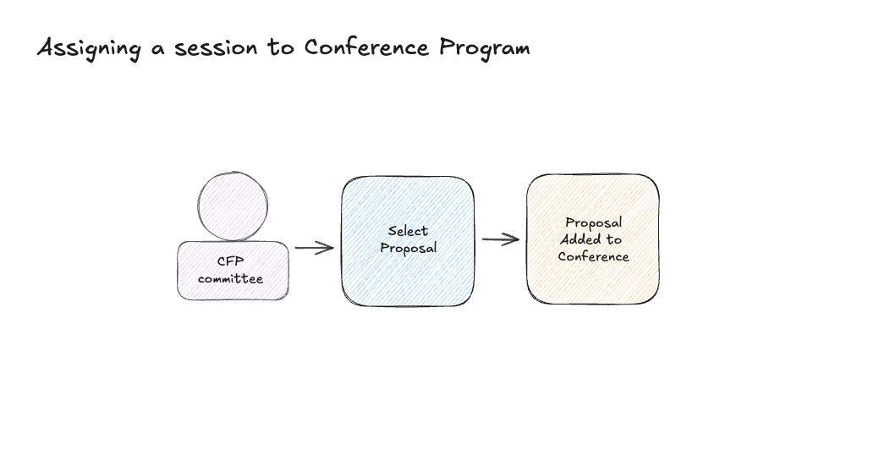
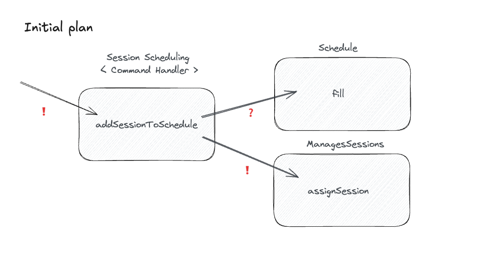
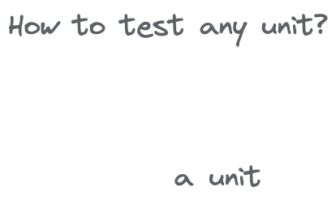
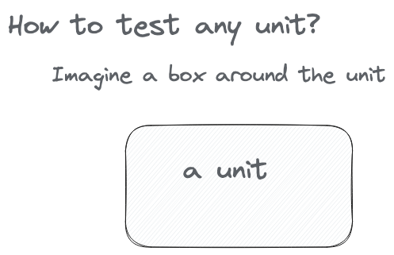
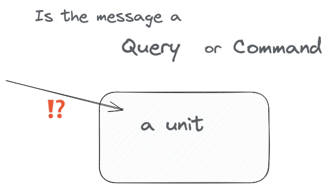
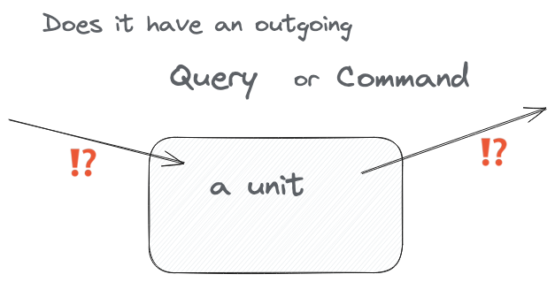
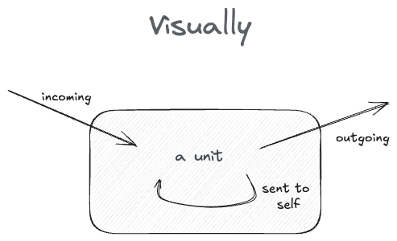

# How to test anything

**Learning goal**: A simple model that shows how to test anything.

**Background info**: This is designed to be used with objects and object-oriented code - but the learnings
are similar in functional languages, too. The example domain is meant to be simple enough to prove the point (of the
testing tricks), and does not necessarily fully align with how conferences are actually run.

The domain is meant to be easy, so the implemented code has the following assumptions:

- you can only pass valid data,
    - no negative numbers,
    - no 0, no null, etc.
- when handling time, it's always in minutes.
    - no need to add a concept of 'time'

**Problem Statement**: As conference organizer, you want to assign proposals to a conference program.



To do this, we have implemented a handler for the 'Select Proposal' commans. it lives in a class called
`SessionScheduling`. The handler knows two collaborators - one that's called `Scheduler` and another called
`ManagesSessions`.

The `Scheduler` responds to a single message called `fill` that tries to fill the schedule according to the
schedule plan of the conference. A conference has a predefined amount of 90, 60, 30 and 15 minute slots, and the `fill`
returns what slots are still available to be filled.

`ManagesSessions`, on the other hand, is the part that will reserve a slot, thus removing an available slot of given
length from the available slots.

The needed classes and their communication pattern is seen in this picture. Note, a question mark denotes a _query_, and
an exclamation mark denotes a _command_


This time, we have a very specific learning goal and that is **not** about finding all the corner cases etc.

> **This is a testing session, not a TDD session.** The production code is already written for you in each language
> folder (e.g. [`javascript/src/`](./javascript/src)). Your job is to write tests for this.

## How this exercise runs - try first, then name it

Each step follows **Training from the Back of the Room (4C)**, in an order tuned for live, hands-on workshops:

| Phase                    | What you do                                                                |
|--------------------------|----------------------------------------------------------------------------|
| **1) Connections**       | Warm up. Guess how you'd test this with what you already know.             |
| **2) Concrete practice** | Grab the provided code and **try to test it first** - with your instincts. |
| **3) Concepts**          | _Now_ we name what you just did and give it a rule.                        |
| **4) Conclusions**       | Loop back to your guess, fill in your cell of the matrix, keep a takeaway. |

Practice comes **before** concepts on purpose: you use your current understanding first, so the concept lands on top of
something you already know - we're not inventing anythign new. Instead, we're harvesting the knowledge you have already,
and we might just give some names to things - and draw boxes.
See [how-to.md](./how-to.md) for the full rhythm.

A core concept of the learning, is the [_learning log_](./learning-log.md), which is meant to be your companion, a place
where you can ink your thoughts. And as that, it serves as a notebook that you can take with you from this session. In
each step, there is an explicit moment when I'm asking you to reflect on something in the learning log. This is an
invitation, yet it's an invitation that I believe serves you. In a live workshop, you can also talk this through with
your pair, if you choose to. For a workshop, if you make a PR of your branch results & learning log, I promise to
comment on your learning, providing one extra level of feedback for you.

## Session Briefing - the model you're filling in

While testing the classes, we'll learn the model by Sandi Metz on 'How to test any unit'.

**Before we start**: Answer the following questions (in the learning log):

- What is difference between a Query and a Command?
- Why does it matter? Why is it important to separate them?

now, go to [Learning log](./learning-log.md)

A message has 2 **types** - 'Query' (returns something, changes nothing) and 'Command' (changes something, returns
nothing). Another category we can split messages on, is the origin - where it came from. A message can be thought of
having 3 **origins**: 'incoming', 'sent to self' or 'outgoing'. That gives a 3-by-2 matrix:

```
          \  Type +-------------+-------------+
              \   |    Query    |   Command   |
          Origin \+=============+=============+
                  |             |             |
     incoming     |   Step 1    |   Step 2    |
                  |             |             |
                  +-------------+-------------+
                  |             |             |
     sent to self |   Step 5    |   Step 5    |
                  |             |             |
                  +-------------+-------------+
                  |             |             |
     outgoing     |   Step 3    |   Step 4    |
                  |             |             |
                  +-------------+-------------+
```

**This matrix is the spine of the whole exercise.** Each step unlocks **one cell** - a different kind of message,
tested a different way. By the end you'll have filled the whole map and have a rule for testing _anything_:

| Step | Cell                 | The class / method you test          |
|------|----------------------|--------------------------------------|
| 1    | Incoming **Query**   | `AvailabilityScheduler#fill`         |
| 2    | Incoming **Command** | `AvailabilityScheduler#setSessions`  |
| 3    | Outgoing **Query**   | `ScheduleAwareAvailabilityScheduler` |
| 4    | Outgoing **Command** | `SessionScheduling#planSession`      |
| 5    | Sent to Self (both)  | `SessionScheduling#planSession`      |

Once these five steps are done, you will have a mental model on how to make easy, simple and robust tests for any of
the 6 categories of tests. And if you choose to go to 'part 2', you'll see how this applies, in my experience, in any
level of testing.

### How to test any unit.

My model for testing any unit is as follows (The Sandi Metz model).

1. **First you choose a unit**



2. Then you **imagine a box around it**:



3. **Any arrows pointing in** - Does it have any incoming queries or commands (exclamation mark = command, question mark = query)?



4. **Any arrows pointing out** - Does it have any outgoing queries or commands?



5. **Anything hidden** - And does it have any messages it sends to self?



Let's see this in action.

## Ready to start?

[Step 1](./step1.md)
