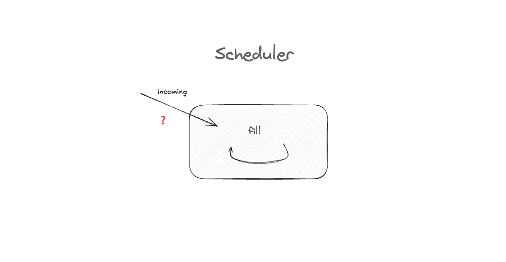

# How to test anything - Step 1: Incoming Query

[..go back](./README.md)

**Learning goal**:

1. What is an incoming message
2. How do you test an **Incoming Query**?

---

## 1) Connections

_Warm up before you touch, or read, the code._

Answer the questions in the [learning log](./learning-log.md#step-1-connections)

---

## 2) Concrete practice

_Try to test it with what you already know. Don't read Concepts yet._

We're focusing on testing, not TDD. The implementation is already done.

- Production code: [`javascript/src/availability-scheduler.js`](./javascript/src/availability-scheduler.js)
- Write your tests in [
  `javascript/test/availability-scheduler.test.js`](./javascript/test/availability-scheduler.test.js)
- Run `yarn && yarn test` in the [`javascript/`](./javascript) folder (or `npm i` and `npm run test`).

### Your task

**Add unit tests for the `AvailabilityScheduler#fill` method.**

- [ ] The `fill` method is tested.
- [ ] Think about coverage: what inputs matter? (a time that fits exactly, a time that fits nothing, a typical time…)
- [ ] You do **not** need to touch the implementation.

Done? Go to [learning log](./learning-log.md#step-1-concrete-practice) and log on your learnings.

---

## 3) Concepts

_Now let's name what you just did._

Let's imagine a box around the thing we're testing. Actually, for a moment, let's imagine being thething we're testing.
In this case, the box is around the `fill` method of the `Scheduler`.

In our tests, we're sending the message `fill` into the `Scheduler` object. Which means, from `Scheduler`s point of view, 
someone else is sending that message to them. So, it's coming from outside of the object. If a message is coming from
outside, it's considered as _incoming message_. 

The origin answers question: _how did we get here - how was this message called?_ If the message is coming from outside, its' **incoming message**.

Thus, `fill` is an **incoming query**: a message that arrives from the outside, **returns a value, and changes nothing
**.

> The rule for an incoming query: **assert the return value.** Nothing else.

In this case, you don't necessarily need to understand the code thoroughly when you start testing. In this situation,
you could just start adding test cases - maybe just reading enough to see some of the number. Like having test cases for
input values of 90, 60, 30, 15. How about any multiples of those, a mix and match.

This approach is often called _Characterization testing_ - you poke around to see what is the behavior when sending
messages with certain input. Having said all this, the key in this exercise is not necessarily what you tested or 
how you found out what to test - but how did you verify that the code is correct.

You did **test the incoming query by asserting the return value**.

### One-minute review

Now is a good time to go to [Learning log](./learning-log.md#step-1-concepts) for some reflective work.

---

## 4) Conclusions

This was a simple task of verifying the return value. 

---

## Finished?

[Step 2](./step2.md)
