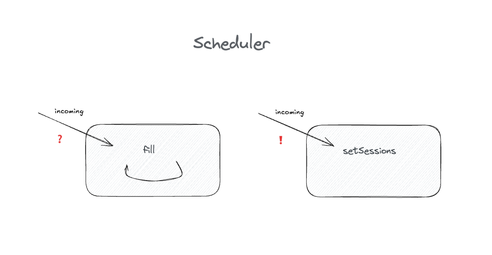

# How to test anything - Step 2: Incoming Command

[..go back](./step1.md)

**Learning goal**:

- What is an **Incoming Command**
- how do you test one?

---
<a id="step-2-connections"></a>

## 1) Connections

In step 1, we asserted a return value of an incoming query. Now we're adding a method `setSessions` which takes a form
of `Array<[ { duration: 90, max: 2 } >` and changes the internal data structure of `AvailabilityScheduler`. Let's first
think how that could be tested. Maybe go to [the Learning Log](./learning-log.md#step-2-connections) and ink your
thoughts.

---

<a id="step-2-concrete-practice"></a>

## 2) Concrete practice

_Try it first._

- Production code: [`javascript/src/availability-scheduler.js`](./javascript/src/availability-scheduler.js) -
  `setSessions(slots)` replaces the current session durations and max counts with the ones provided.
- Tests go in [`javascript/test/availability-scheduler.test.js`](./javascript/test/availability-scheduler.test.js).

One possible way to send the message `setSessions` to the scheduler is:

```javascript
const scheduler = new AvailabilityScheduler()

scheduler.setSessions([
  { duration: 45, max: 3 },
  { duration: 20, max: 5 },
  { duration: 10, max: 10 },
])
```

### Your task

**Plan how you'll test `setSessions`, then test it.**

- [ ] `setSessions` is tested.
- [ ] `fill` is tested with the previous tests - no need to change previous tests.

Done? Maybe time for a bit of reflection in your [Learning log](./learning-log.md#step-2-concrete-practice)


---
<a id="step-2-concepts"></a>

## 3) Concepts

_Now let's name it._



`setSessions` is an **incoming command**: a message from the outside that **changes internals** of the object causing
some change in behavior, while it **returns nothing**.

> The rule for an incoming command: **assert the return value of the direct side-effect**.


You can't assert a return value - there isn't one. So you assert the **publicly observable effect**: call the command,
then observe the change through the object's **public surface**. Here, there are two public evidences that `setSessions`
worked. There is the query `getSessions`, which returns the internals of the object, and there is the change of behavior
of `fill(...)` method.

How should we go ahead and test this? To be honest, the `getSessions` function is there only as a trap - yet that is the
method 90% of the pairs have chosen to test it during all my workshops the past years when I have TDDed this workshop
through.

Let's see one caveat of this design decision of exposing a query to internals of `AvailabilityScheduler`. When we return
an array, we give the caller a reference to the exact memory location of where the internal `#slots` are. Why does that
matter? No-one would do anything bad for this, right? Not necessarily the very caller, but what if the caller would pass
that data structure around - and later, in few months, someone, somewhere would go ahead and modify the data structure
"just a tiny bit". This is scary.

To see this in action, try to run this test in your tests - but first discuss with your pair: does this succeed or fail?

```javascript
it('returning internals is scary - anyone can change the #slots from now on', () => {
  const a = new AvailabilityScheduler()
  const b = a.getSessions()
  b.shift() // remove one element from the array?
  expect(a.fill(90)).to.be.eql([90])
})
```

Just having a reference to an array - and anyone can go ahead and modify it's content? 

So, the reason to have this one simple step of adding a `getSessions` is to show how adding a getter into the public
interface can invite bugs. I think no-object should see the internals of other objects. Object Oriented Programming was
(originally) about sending and receiving messages. What can you send, what can you respond to? But that's worth another
workshop, so let's stop talking about that for now.

So, the way we want to test incoming query is to test the **observable behavior change**. And the change happens here
on the `fill` method. So, if you did not test it like that, please go ahead and add your test.

```javascript
it('One example way of testing observable behavior change', () => {
  // Arrange
  const a = new AvailabilityScheduler()
  // Act
  const b = a.setSessions([{ duration: 45, max: 3 }])
  // Assert - now there are no 90 min slots available
  expect(a.fill(90)).to.be.eql([45, 45])
})
```

### What is _direct_ side-effect?

Remember the box we're drawing around a unit? Now depending how big the box is you are drawing - does the side-effect
happen within the box? If yes - it's direct side-effect.

if the change happens in DB, is that a direct side-effect? Think of testing a DB adapter. Yes? No? Depends?

It all boils down to how you draw the box.

### Time for some reflective work.

Please, head to your [Learning Log](./learning-log.md#step-2-concepts) and spend a few minutes thinking and inking on
what you have learned, if any.

### One-minute review

---

<a id="step-2-concepts"></a>

## 4) Conclusions

The model we're going through - and I'm forever grateful for Sandi Metz for her work on programming - is one I'm using
in when thinking any kind of tests. Let's imagine a situation where I'm workign on a new feature on a component. I might
start with an outer, customer facing test, where I'm sending an HTTP POST method, and I'm asserting the observable
side-effect it has. The side-effect can be an event sent to an event bus. Or it can be that the data changes on the next
query. This, which could be a 'component test', or 'integration test' might have database _inside the box_. And then I
treat it like it was a unit test. And I use the model from Sandi Metz.

Just imagine a box around the unit, and ask the 3 questions. Easy.

One last thing before going to step 3 - time for final thoughs on
your [Learning Log](./learning-log.md#step-2-conclusions).


---

## Finished?

[Step 3](./step3.md)
