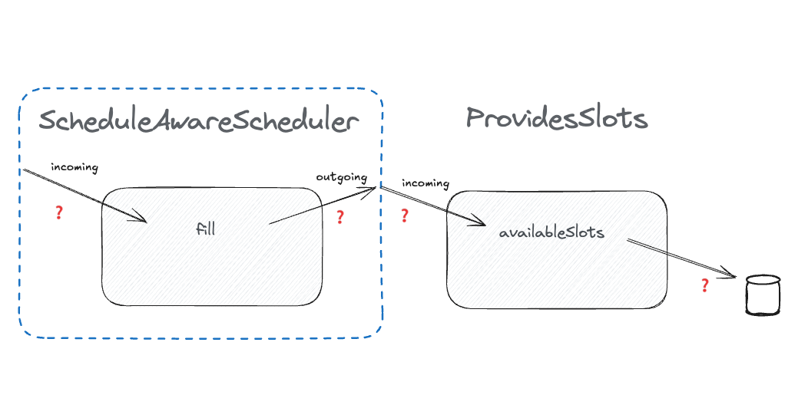

# How to test anything - Step 3: Outgoing Query

[..go back](./step2.md)

**Learning goal**:

- What is an **Outgoing Query**,
- how do you test one?

---

<a id="step-3-connections"></a>

## 1) Connections

So far we're testing a method that does not make any calls to any other collaborator. And for this session, a
collaborator can be thought as an entity, or rather a _shape_, that knows how to respond to certain messages (remember,
Object-Oriented Programming is about sending and receiving messages - which is useful thinking even if we would not be
talking about objects).

For this task, the Scheduler needs to get the available slots from somewhere. Somewhere (over the rainbow?), there is
data stored that knows what slots are still available. `AvailabilityScheduler` clearly does not have that data - because
then it would have more than one responsibility -> and it will have a collaborator from who it can get the slots.

Now let's introduce a new class (in real, we'd start extending the original, but for the sake of focus on testing...)
[`javascript/src/schedule-aware-availability-scheduler.js`](./javascript/src/schedule-aware-availability-scheduler.js) -
a class that can get the slots from a collaborator playing role 'ProvidesSlots'.



The image depicts the rough idea. We're testing the `ScheduleAwareAvailabilityScheduler`, and it sends a message
`availableSlots` to the collaborator. From our test perspective (the box we're imagining), what happens outside of the
box we don't know - nor even care. From the test perspective, what we care is that the collaborator answers to our
message with data that is of correct shape.

Before jumping into the code, maybe spend a minute or two with a bit of
[reflection on your Learning Log](./learning-log.md#step-3-connections).

---
<a id="step-3-concrete-practice"></a>

## 2) Concrete practice

_Try it first._

The challenge is to test the `fill` method of
[`javascript/src/schedule-aware-availability-scheduler.js`](./javascript/src/schedule-aware-availability-scheduler.js),
which has same logic as the previous query, but it does send a message to collaborator `providesSlots`.

### Your task

**Test that `ScheduleAwareAvailabilityScheduler#fill` correctly uses sessions from its injected source.**

- [ ] The scheduler is tested.
- [ ] The tests do **not** use a production implementation of `ProvidesAvailableSlots`.
- [ ] `fill()` behaves exactly as in Step 1, but now driven by the injected slots.

Done? Time for reflection in your [Learning Log](./learning-log.md#step-3-concrete-practice)

---

<a id="step-3-concepts"></a>

## 3) Concepts

_Now let's name it._


### Test Doubles

In the book [xUnit Test Patterns](https://www.oreilly.com/library/view/xunit-test-patterns/9780131495050/), there is a
captured vocabulary for different kinds of _shapes_ we use in our tests, as substitute for the production-ready
collaborator. In tests, these _seams_ - where we can inject a predefined shape for the collaborator - makes it easy
for us to instruct the code to behave deterministically, and thus easier to test.

In the book, there is listed 5 different kinds of **Test Doubles**, where the word Test Double is a sort of umbrella
term for all of them. The 5 kinds are _dummy_, _fake_, _stub_, _spy_ and _mock_. Each of them has their own use, and
each have their own behavior. Understanding the differences makes it easier to know what to use where.

### How to use a Test Double.

In this situation, `ScheduleAwareAvailabilityScheduler` requires a collaborator of the following shape: The shape
consists of being able to respond to one message, named `availableSlots`, which returns a shape of
`Array<{duration: number, max: number>`.

From inside the test subject, calling `collaborator#availableSlots` is an outgoing query - because it goes from inside
the imaginary box to outside of the box (turning into incoming query of the 'ProvideSlot' production code).

In this situation, our job is to use one of the five possible types of test doubles, suitable for to be used in this
situation.

A test could look like

```javascript
import { ScheduleAwareAvailabilityScheduler } from './schedule-aware-availability-scheduler'

it('knows how to fill schedule')
{
  const providesSlotsShape = { availableSlots: () => [{ duration: 15, max: 4 }] }
  const scheduler = new ScheduleAwareAvailabilityScheduler(providesSlotsShape)

  expect(scheduler.fill(60)).to.eql([15, 15, 15, 15])
}
```

What you see here is the intrinsic concept of a 'shape' - It's not an Object (capital O), it does not have a name. the
only _shape_ it has is that it knows how to respond to a message called `availableSlots`, and it returns a correct type
of shape back. This, is what I would call a _stub_ - it returns a canned answer to every time responding to the message.

> It's actually useful to learn how to write your own test doubles in the language you are working with. I encourage 
> everyone to learn to do it.

### How to test an outgoing query?

We might be inclined to verify (with a _mock_), that we're actually calling the outgoing query. This is unfortunate, as
from testing point of view, we're then testing the implementation, and not the behavior. We're injecting too much
knowledge of the internal implementation into the test case. This might, in the long run, make the tests fail if we make
some changes on the collaborator.

Instead, we do not explicitly test that the method is being called. It's tested implicitly when testing the behavior of
the `fill` method.

> The rule for an outgoing query: **don't test it.** You don't assert that the query was sent, and you don't assert
> what it returned. You just **inject a stub/fake** that returns known slots, so you can test _this_ object's real
> behaviour (`fill`) against predictable input.

You might think this is not enough? But it is in the end - remember: an outgoing query on our side is an incoming query
on the other side. And we know already how to test an incoming query.

### Why don't we test the outgoing query?

- **An outgoing query is someone else's incoming query.** From the collaborator's point of view, `availableSlots()` is
  an _incoming query_ - and you already know how to test that (Step 1). So it gets tested _there_, against the
  collaborator, with the very same heuristic. Testing it again from here would be duplicate coverage. Trust the shape
  and the contract.
- or, **You draw the imaginary box around both classes**, possibly removing any outgoing messages. It's totally Ok to
  unit test more than one class as a unit. It's just the box we imagine around a bit larger context.

> _On "interfaces" in dynamic languages:_ in JavaScript / Ruby / Python (and TypeScript) you can think of an interface
> as a **shape** or **protocol** - a role an object plays by responding to the agreed messages. Abstract, yes, but it's
> what an object _is_: **something that responds to a message as agreed by the protocol.**

That was a lot of concepts. Time for review - please open your [Learning Log](./learning-log.md#step-3-concepts) and
finish this part

---

<a id="step-3-connections"></a>

## 4) Conclusions

Any questions on the types of test doubles?
Maybe [go to Martin Fowlers web page](https://martinfowler.com/bliki/TestDouble.html) to read more.

I invite you one more time to [Learning Log](./learning-log.md#step-3-conclusions).


---

## Finished?

[Step 4](./step4.md)
