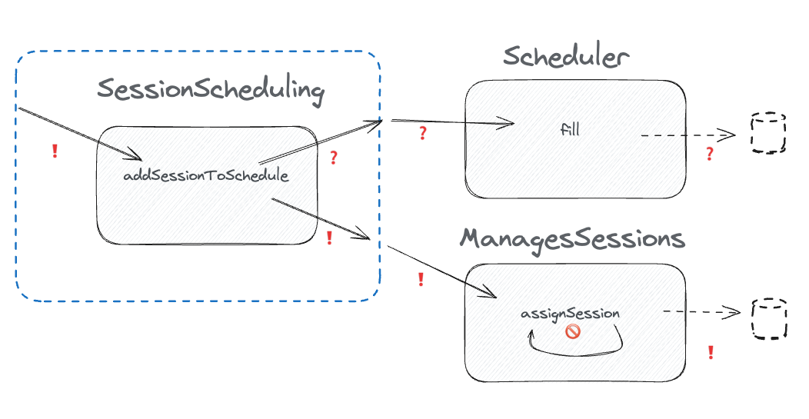

# How to test anything - Step 4: Outgoing Command

[..go back](./step3.md)

**Learning goal**:

- What is an **Outgoing Command**
- how do you test one?
- This is the handler that was the programming goal of the whole exercise.

---

## 1) Connections

We have the building blocks now ready for the final task of this challenge - we need to test the behavior, that
given a conference proposals and available slots, we test the behavior that we're assigning the proposal into the
conference.

---

## 2) Concrete practice

_Try it first._

### Grab the code - don't write it

The logic of the Session Scheduling is:

1. send message `fill` to collaborator `Scheduler` (this is the logic we implemented in previous step)
2. if the conference still has available slot long enough, send message `assignSession` to the '
   managesConferenceSessions'
3. if there are no slots long enough available, throws exception

The logic should be working, and your job is to test it.

- Production code: [`javascript/src/session-scheduling.js`](./javascript/src/session-scheduling.js)
- The production collaborator:
  [`javascript/src/conference-session-managing.js`](./javascript/src/conference-session-managing.js) - do **not** use
  it in your tests.

### Your task

Your task is to **test the `SessionScheduling#planSession`**, and use the knowledge we have built so far.
To test this, start writing a test list of the algorithm. It could

- [ ] `SessionScheduling` is tested.
- [ ] The tests do **not** use the production `ConferenceSessionManaging` class.
- [ ] Cover both paths: a slot is found (so a session is assigned) and no slot fits.

Done? maybe time for a bit of reflection, see [Learning Log](./learning-log.md#step-4-concrete-practice)

---

## 3) Concepts

_Now let's name it._

`this.#managesConferenceSessions.assignSession(...)` is an **outgoing command**: this object tells a collaborator to
change the world, and expects nothing back.

> The rule for an outgoing command: **verify that the message was _sent_.** You use a **mock / spy** as the
> collaborator and set an expectation: `assignSession` _was called_, once, with the right session and slot. This is
> "expect to send."

Contrast the two outgoing cells you've now met:

| Outgoing message | Example            | How you test it                                |
|------------------|--------------------|------------------------------------------------|
| **Query**        | `availableSlots()` | **Ignore it** - stub it, test your own logic   |
| **Command**      | `assignSession()`  | **Expect to send** - mock/spy, assert the call |

Why the difference? A query has no effect on the world, so there's nothing to verify about the _sending_ - only your
use of the answer matters. A command's entire purpose is the effect on someone else; the _sending_ **is** the
behaviour, so that's exactly what you assert. 

Why do we test the flow of not finding a slot, then - why do we verify that a message is not sent? That is part of the 
core behavior of the code we're testing - a messages is/is not sent is the behavior for _this_ class.

Time for a quick recap in the [Learning Log](./learning-log.md#step-4-concepts)

---

## 4) Conclusions

A program without side-effects would not be too useful. It would always do exactly the same thing it always does. Thus,
side-effects, and I/O in general, is core concept of any piece of code. Testing them, on the other hand, might have 
been tricky. But on the model from Sandi Metz, it's made easy - you either "assert the return value of the direct
side effect", or you "verify that message is being sent". This is enough, because 

> outgoing query on one end is an incoming query on the other

This is the key of the whole model. Simple model that proves to be working in fractal nature. It works regardless of 
how big the imaginary box is. 

One last time in the [Learning Log](./learning-log.md#step-4-conclusions) for this step.

---

## Finished?

🎉 Done! 🎉 You only need to see what we'll do with private methods (messages that are _sent to self_). So please jump 
to [step 5](./step5.md)
