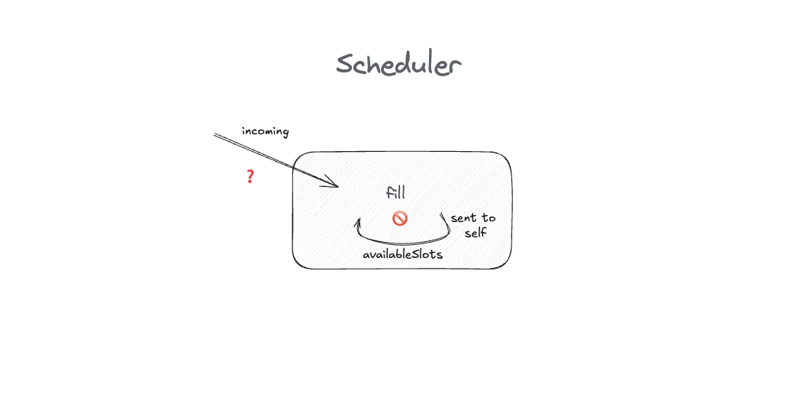

### How to test private methods?

> **We don't test private methods.** They're an implementation detail. They get exercised - and covered - through the
> public messages that use them.

Yay! 🚀🎉🏁, you did it. Maybe just [check the Summary](./summary.md) for last few words.