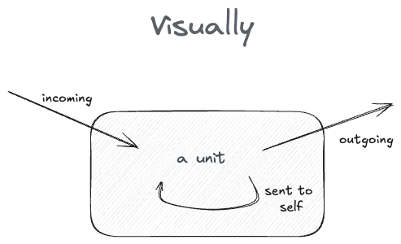

# How to use these steps

[..go back](./README.md)

The learning goals for this part are:

## 3-by-2 matrix of every message:

We learned that we don't want a query to have a side-effect, because that's an easy way to introduce bugs. Instea, we
want a clear separation between queries from commands.

| type    | key characteristic               |
|---------|----------------------------------| 
| query   | a message that returns somethign | 
| command | a message that has a side-effect | 

A side effect can be in database, in memory, file system, or even a call to another service. Even writing to a log can 
be thought as a side-effect, especially from pure FP (functional programming) point of view.

A message has 3 different origins. It originates (hence the name 'origin') some other class calling me (incoming), it is
sent to self (a private message) or the origin is this very method, but it's sending the message to a collaborator (
outgoing), see


This all gives us the 3-by-2 matrix and how we test them.

```
          \  Type +-------------+---------------------+
              \   |    Query    |   Command           |
          Origin \+=============+=====================+
                  |   Assert    | Assert return value |
     incoming     |   return    |         Of          |
                  |   value     | DIRECT side-effect  |
                  +-------------+---------------------+
                  |             |                     |
     sent to self | Do not test |    Do not test      | 
                  |             |                     |
                  +-------------+---------------------+
                  |             |                     |
     outgoing     | Do not test |  Verify message is  |
                  |             |       sent          |
                  +-------------+---------------------+
```

## The matrix is the map

Every step fills **one cell** of the Query/Command × Origin matrix in the [README](./README.md). Keep that matrix
when you're thinking your next unit tests.

| Step | Cell                 | Rule you'll land on                                 |
|------|----------------------|-----------------------------------------------------|
| 1    | Incoming **Query**   | Assert the returned value.                          |
| 2    | Incoming **Command** | Assert the return value of the _direct_ side-effect | 
| 3    | Outgoing **Query**   | Don't test it - inject a stub or fake.              |
| 4    | Outgoing **Command** | Verif message being setn.                           |
| 5    | Sent to Self (both)  | Do not test                                         |
