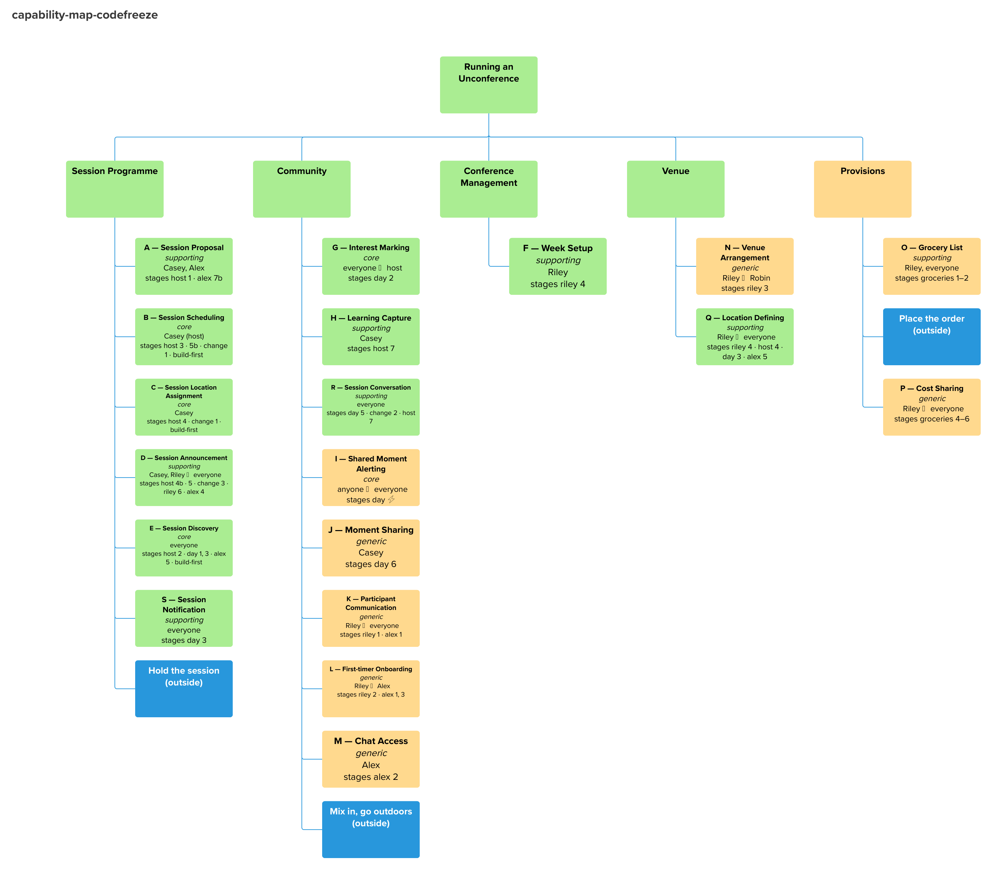

# Capabilities and Composition.

To understand a bit of the architecture and design of the Codefreeze Board, it might be useful to have a word about
Business Capabilities, and composition. This is something a real 🤯 for me, when I saw this in real, and how this can
affect software systems.

## A Business Capability.

At SoCraTes 2026, we came up with a definition of

> Business Capability: What we must do as an org .. to achieve our purpose .. for our beneficiaries.

It describes what we do, not how we do it. No technical jargon. Just what needs to happen. It's also **inherently
stable** over time.

Let's see this in example in Codefreeze Board.

## Codefreeze Board.

Codefreeze is an open space conference, originated from SoCraTes events. It is a slightly different than a normal
SoCraTes - it lasts a week, during the daylight (from 10am to 2pm), we mostly enjoy the Lapland nature. Most of the
sessions happens after 3pm. And at any given moment, someone might shout "AURORAS", and then every single session stops,
and people dress up (for -25C temperaturs) and go out in the fjells to photograph and enjoy the view.

There is no visible wall of board. Things change - a session marked to start at 8pm might be moved at an instant. The
way we organise things is by using a board. Run this, and you see how that roughly works.

But is it different to run a SoCraTes at Soltau, or Codefreeze at Kiilopää, Lapland? Yes. Do we have the same business
capabilities? Let's see a Business Capability Map I created for the Codefreeze Board.

### Business Capabililities of Running an unconference.

What I wrote here says - running an unconference has 4 sub-capabilities: "Session Programme", "Community", "Conference
Management" and "Venue". The 'Provisioning' is very Codefreeze specific. I personally think I see these 4
sub-capabilities also present at SoCraTes.

Let's focus on Session Programme. It consist of

- _Session Proposal_ - where someone proposes a session.
- _Session Scheduling_ - when the session is happening
- _Session Location Assignment_ - where the session is happening
- _Session Announcement_ - people need to know about the session.
- _Session Discovery_ - and have easy access to see what's happening.
- _Session Notification_ - it's starting now.

I would say, based on my SoCraTes experience, that all these are capabilities both Codefreeze and SoCraTes have. Yet,
there is one big difference - in SoCraTes, these can be achieved with a physical board & a market place. For Codefreeze,
a board like the one we're working does provide a lot of value.

(having said this, SoCraTes does have also an electric board - there's people typing the proposals to the eboard during
the market place.)

This is the core of Business Capabilities. It says **What needs to happen** - and it matches both, but does not, at all,
say how it should be done.

## Composition.

Second part of the "To-be" talk of mine.

So, we have capabilities. They are autonomous. We need to deploy them somewhere to build apps. Does capabilities guide
us towards Microservices architecture (well, a capability also happens to be the **stable**, so a very good candidate
for microservice boundary)?

Yes, and no. Yes - it's very easy to go towards microservices, because you tend to have the right boundaries. And no,
**because the whole question is wrong**, when working with **Capabilities and Composition**.

The thing what ends up being is just a question of "Where and how do we serve these capabilities".

I'll give you an example. Again, Codefreeze board.

### Composition example.

On this repo, the Codefreeze board is a composition of all the capabilities running in a single monolith. The only thing
that _main_ does, it registers a bunch of capabilities (well, all of them), initializes them with the proper
infrastructure (postgres, rabbitmq - or pglite + in-memory bus) and has it running. 

And, and this is the cool part - in the real repository for Codefreeze Board, this nodejs host is just one way to deploy
the app. I also have an AWS serverless version. Just building new infra layer (lambda handlers, EventBridge, DB) - and 
passing them into the core domain. 

Core domain does not change. I have 3 ways to run the app - all with exactly the same domain code:
 - Serverless on AWS
 - NodeJS with postgres + rabbitmq (e.g using Docker)
 - fully in memory.

A set of capabilities can be composed into whatever shape of services you like. Then microservice vs. monolith becomes
financial decision only - which makes more sense.