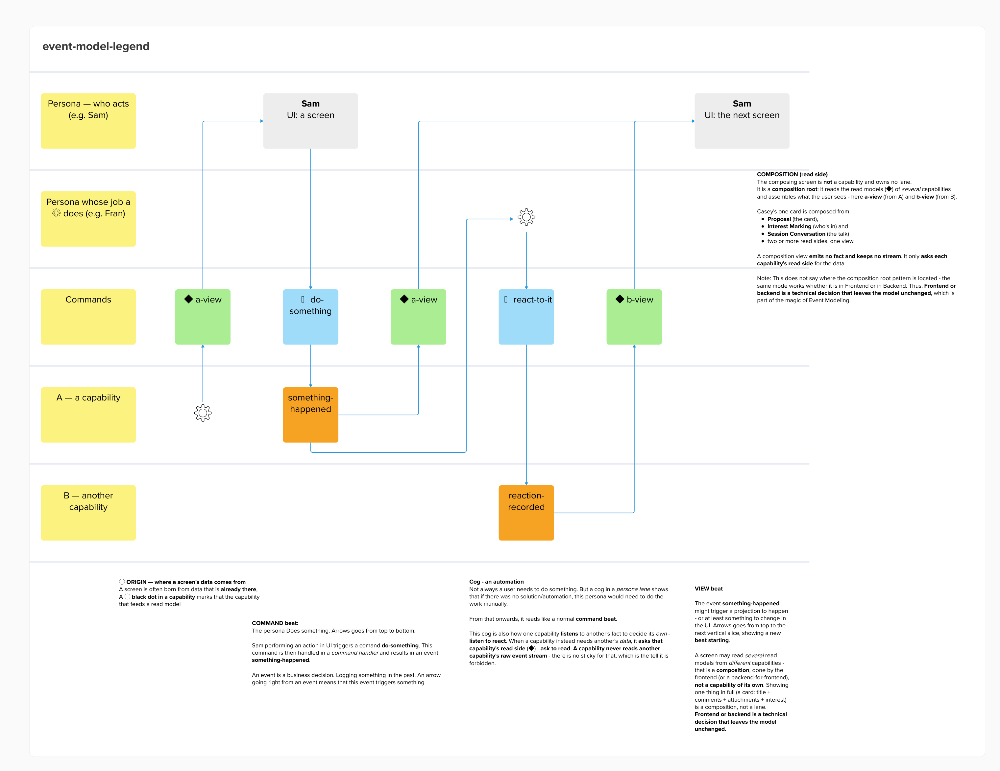
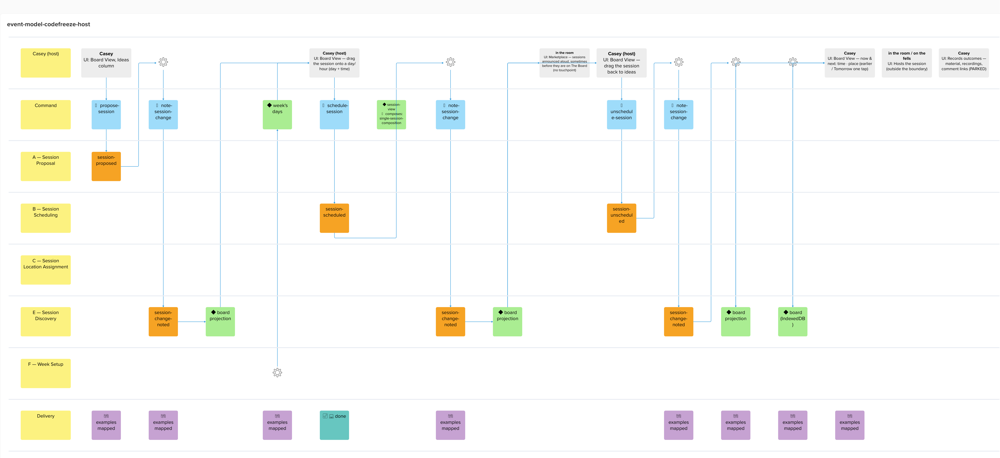

# Event Modeling

..or how to read the event models in this context. Let's see an example event stream, a legend.

.

first about colors:

- blue: command
- gree: state
- orange: event
- others: mostly irrelevant (in this context)

What you see on the first column is personas (Sam and Fran). They are people who are the beneficiaries (or us) for the
organisation. These personas can originate from Empathy Mapping, or similar.

Then there is 'commands' (or 'commands / state') which is a to give a name for a command / state that is flying around
during the lifetime of the app. The command/state row is sort of crucial - a lot of information is seen in that column.
Like what is the command Sam is performing.

From a command, there is an arrow to an event. An event is a business decision stored as a fact that has happened. Sam
'going something' cause 'something happend' to happen. That event then can be seen in a projection - a view in some UI.
Whether there is a write-side or read-side projection, that does not really matter - it's often a technical decision and
not necessarily need to be in the event model (it can, if it makes sense).

An event can also trigger another event. See the arrow from 'something happened' to the cog on 'Fran's lane. This read
as follows: If there was no automation, Fran would react to 'something happened', but as we now have automation, this
just happens. This can trigger another command->event transition.

## Codefreeze board Event models.

For this exercise, I have prepared two event model. One is for the session host, Casey - Casey is the persona of
Codefreeze attendee who'll host some sessions.

This event model says in short (I go through all beats one by one):

1. Casey can propose a session from the Board view. It triggers a command for **SessionProposal** and that saves an
   event
   `session-proposed`
2. **SessionDiscovery** is listening to the `session-proposed` event, and saves own event 'session-change-noted'
3. **SessionDiscovery** listens to 'session-change-noted' event, and updates a write-side projection of the board (it
   stores a projection into DB)
4. **SessionDiscovery** broadcasts the changes for the said event to all clients registerd via WebSockets.
5. **WeekSetup** provides data for beat 5
6. Casey can move a session into a slot in the Board View by drag-and-drop. This causes a command _schedule-session_
   that **SessionScheduling** logs into a decision (i.e. event) `session-scheduled`
7. **SessionDiscovery** is listening to this event, too, and logs another `session-change-noted` on the same stream of
   the session
8. same as 3 & 4.
9. Casey unschedules a session (moves to ideas in the board view). **SessionScheduling** owns the command-to-event
   transformation and dispatches an event `session-unscheduled`
10. same as 7.
11. same as 8.

## using Sandi Metz model in this testing.

.. do not read any longer if you have not done the workshop yet. Real spoiler alert.

In theory, you can take any vertical slice, and make a box around it. Or you can take any number of connected vertical
slices and make a box around it. Just some examples:

A box from 'Propose Session' -> event `session-proposed`. A 'session proposed' HTTP call is the incoming command (well,
also query, because HTTP). It has one outgoing arrow, the `session-proposed' event. What kind of test this is?

- component test?
- integration test?
- end-2-end test?
- none of the above?

If you chose 1, 2, or 4, I'd agree with you. It's sort of component test, sort of integration test, and sort of neither.
For me, a component test does not include a database. Well, maybe an in-memory DB that has been contract tested, But in
this application, component test boundary is the infra boundary. If there is a DB, it's not component test.

An integration test, in this repository, is one where I have postgres, and I have RabbitMQ running on Docker. So I'm
testing not only the code, but also the wiring.

I do have tests for the command to event sent. But it does not match either of my definitions. The reason is: in order
for event to be dispatched, it must first live in the event store (which is DB in postgres). Then there is a poller, or
such that takes all unpublished events, and keeps on publishing them. This is infra concerns - and the business
capabilities have zero knowledge of this. They only save events to stream, and then magic happens (do you see the
exactly same shape here that I preach about when talking about Object Oriented Programming? Fancy, right?).

So, for this use case - when I'm testing 2 beats, or beat+infra setup, I call it 'component-integration'. It uses a
contract-tested in-memory DB (not event pglite) that is guaranteed to behave like a real DB (I do have contract tests in
the real repo).

Let's get back from the detour.

## Testing _Propose session_ -> `session-proposed`

- For component test, make an HTTP call using `supertest`, verify that the event is stored in the DB (this is outgoing
  command)
- For component-integration test, make HTTP Call using `supertest` and verify that event is sent to rabbitmq (using the
  nullable spy)
- For integration test (you can have integration test for a single beat, too), make HTTP call using `supertest` and
  listen a queue on the rabbitMQ. Have RabbitMQ running on docker.

The similar structure can be thought on all the boxes you can draw in this session.
